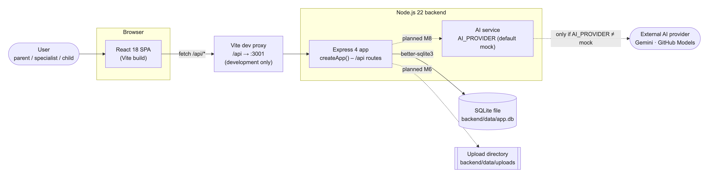
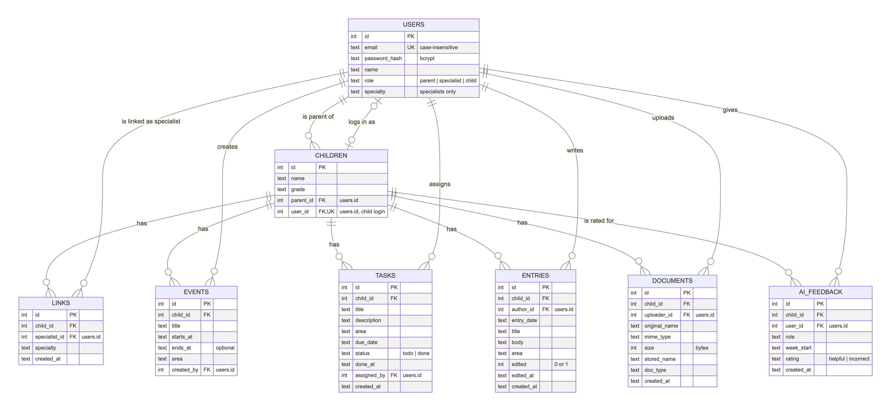
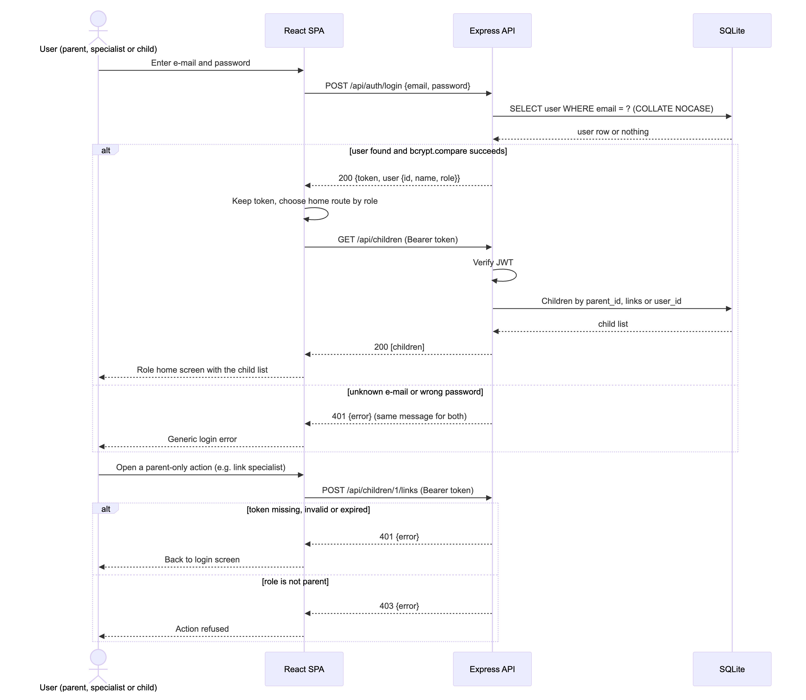
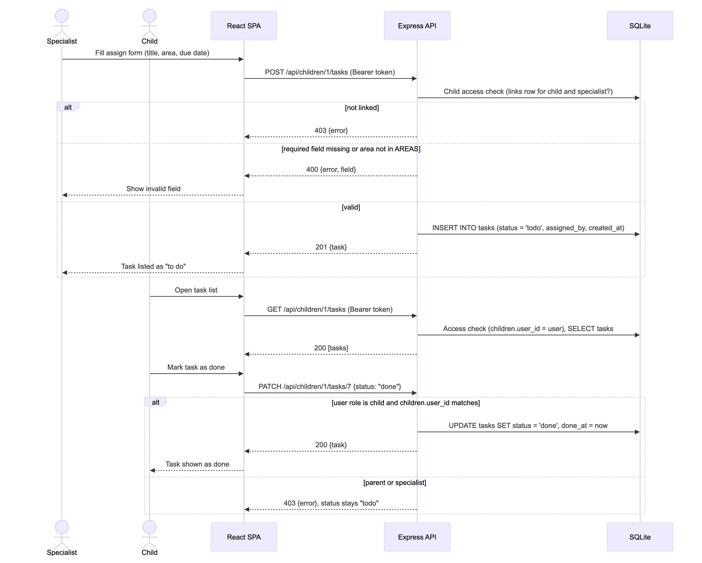
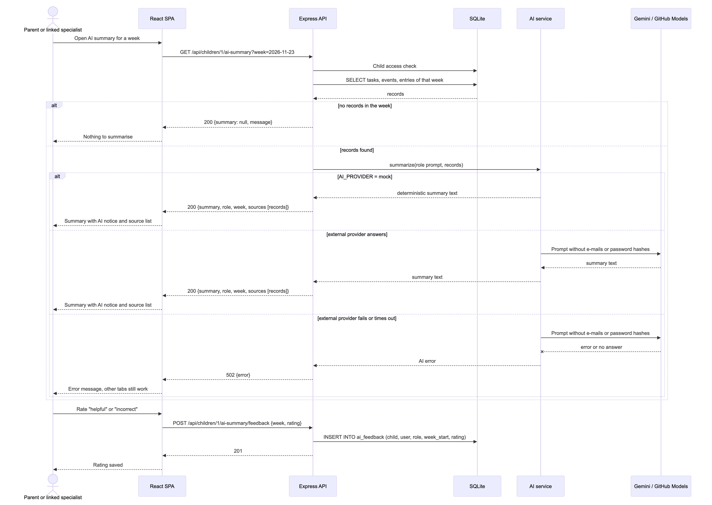
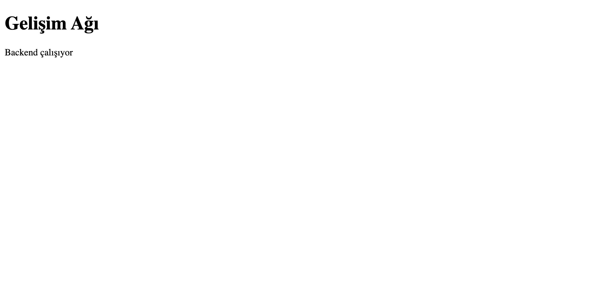
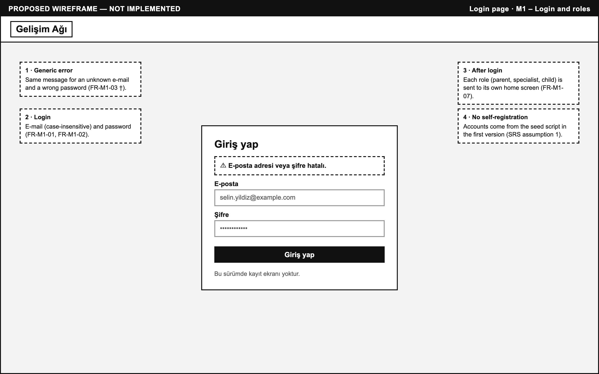
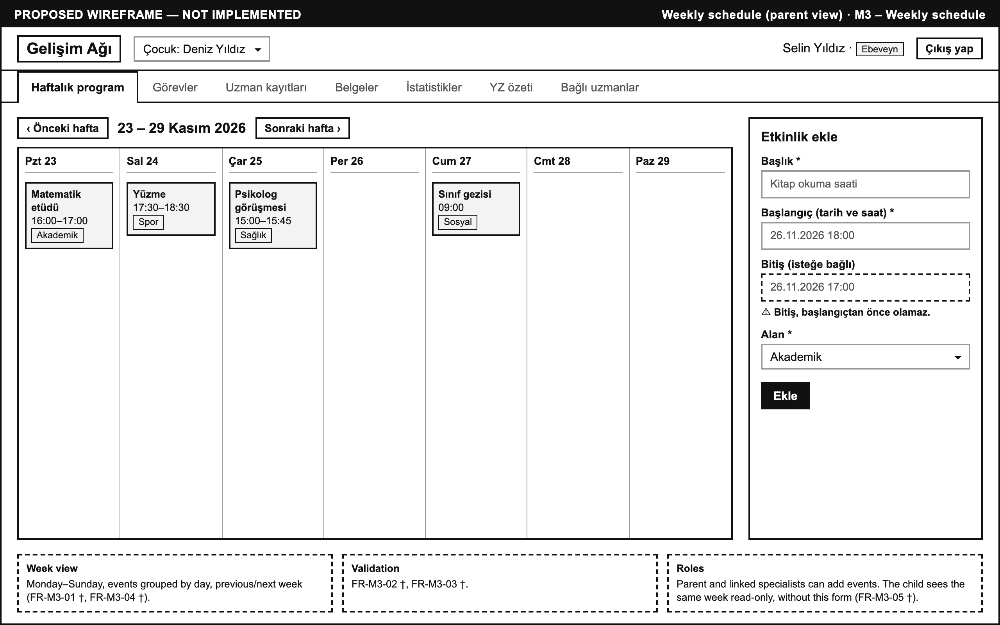
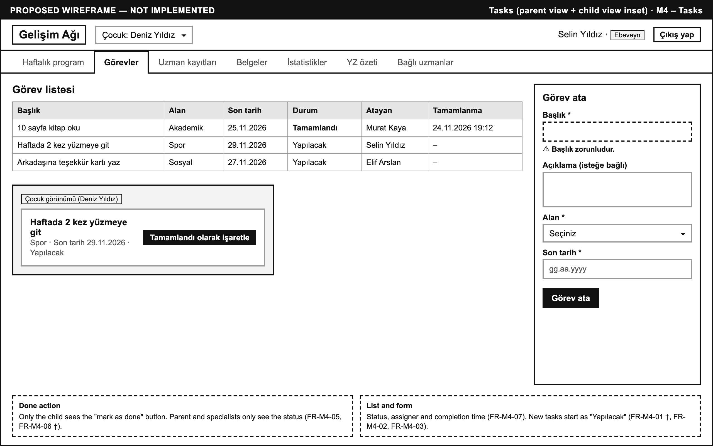
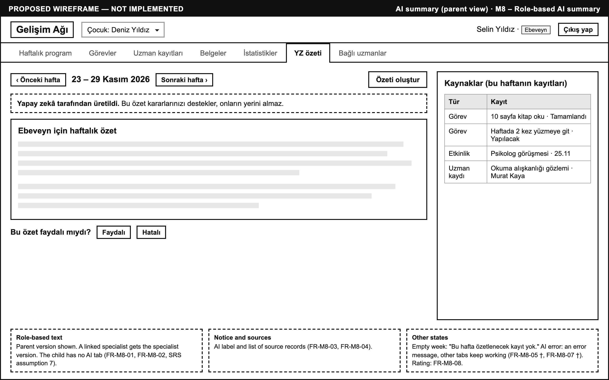

# Software Design Document (SDD)

**Team name:** CoreStack (Group G1, Section-1)  
**Version:** ☒ First version (Week 6) ☐ Final (Week 10)  
**Last updated:** 2026-10-25  
**Project:** Gelişim Ağı – AI-Assisted Child Development Platform

Requirement IDs refer to SRS.md. Each component below is labelled **Implemented** (it exists on main) or **Planned** (it is not yet built). Planned components come from Jira task titles, except where a row says "proposed". Their internal design, endpoint paths and status codes are proposals that may change when the task is implemented. The login-token library and the file-upload library are not chosen yet.

# 1\. Architecture Overview

Gelişim Ağı is a three-tier web application: a React single-page app (built with Vite) calls a REST/JSON API under /api, served by a Node.js + Express backend that stores data in a single SQLite file through better-sqlite3. In development the Vite dev server proxies /api to the backend on port 3001. Uploaded files will be kept on disk next to the database. AI summaries will come from a backend AI service that either uses a built-in mock or calls an external model. The configuration already has settings for Gemini and GitHub Models.

Solid arrows are implemented. Dashed arrows are planned.

## Technology Stack

| **Layer** | **Technology** |
| --- | --- |
| Frontend | React 18.3, Vite 5.4 (@vitejs/plugin-react). Implemented. |
| Backend | Node.js ≥ 22, Express 4.21 (CommonJS). Password hashing with bcryptjs 3 (used by the seed script). Implemented. |
| Database | SQLite via better-sqlite3 13 (foreign keys on, WAL journal for file databases). Implemented. |
| Authentication | JWT (named in Jira task CST-24, secret read from JWT\_SECRET). Planned, library not chosen. |
| File uploads | Disk storage in UPLOAD\_DIR with a 10 MB limit in the config. Planned (CST-44), library not chosen. |
| AI | Provider selected by AI\_PROVIDER (default mock). Config holds GEMINI\_API\_KEY/GEMINI\_MODEL (default gemini-2.5-flash) and GITHUB\_TOKEN/GITHUB\_MODEL (default openai/gpt-4o-mini). Planned (CST-51), only the config exists. The provider names other than mock are not fixed yet. |
| Testing | Jest 29 + Supertest 7 (backend), Vitest 2 + Testing Library + jsdom (frontend), coverage with Jest and @vitest/coverage-v8. Implemented. Playwright end-to-end tests are planned (README, CST-26 and later). |
| CI | GitHub Actions (.github/workflows/ci.yml) on Node.js 22: backend tests with coverage, frontend tests with coverage and the frontend build, on every push to main and every pull request. Implemented. |

There is no Docker or deployment configuration in the repository. The application currently runs only in development mode.

# 2\. Module Design

| **Module** | **Main components** | **Implements requirements** |
| --- | --- | --- |
| M1 – Login and roles | users table (implemented). Auth API with JWT and role middleware, login page and role-based routes (planned, CST-24/25). | FR-M1-01 – FR-M1-09 |
| M2 – Linking specialists | children and links tables (implemented). Links API, child access check, linked-specialists page (planned, CST-28/29/30). Children list endpoint (proposed). | FR-M2-01 – FR-M2-07 |
| M3 – Weekly schedule | events table (implemented). Events API with week filter, weekly schedule view, add-event form (planned, CST-32/33/34). | FR-M3-01 – FR-M3-05 |
| M4 – Tasks | tasks table (implemented). Tasks API, task list and assign form, child "done" action (planned, CST-36/37/38). | FR-M4-01 – FR-M4-07 |
| M5 – Specialist entries | entries table (implemented). Entries API with "edited" mark, entries tab and form, edit own entry (planned, CST-40/41/42). | FR-M5-01 – FR-M5-06 |
| M6 – Documents | documents table, upload settings in config (implemented). Documents API with upload checks, documents tab, view and download (planned, CST-44/45/46). | FR-M6-01 – FR-M6-06 |
| M7 – Weekly statistics | Statistics service and API, statistics tab (planned, CST-48/49). | FR-M7-01 – FR-M7-05 |
| M8 – Role-based AI summary | AI config, ai\_feedback table (implemented). AI service with mock mode, parent and specialist prompts, AI summary API with sources, AI summary UI (planned, CST-51–54). | FR-M8-01 – FR-M8-08 |

The tables below give the details per module.

## Shared foundation (all modules)

| **Component** | **Status** | **Responsibility** |
| --- | --- | --- |
| backend/src/app.js – createApp() | Implemented | Builds the Express app: disables x-powered-by, parses JSON bodies up to 100 kB, serves GET /api/health, answers unknown /api paths with a JSON 404. Module routers will be mounted here. |
| backend/src/server.js | Implemented | Starts the app on PORT (default 3001). |
| backend/src/config.js – loadConfig() | Implemented | Reads PORT, JWT\_SECRET, DB\_PATH, UPLOAD\_DIR, AI\_PROVIDER, GEMINI\_\*, GITHUB\_\* with development defaults. Sets the upload limit to 10 MB. |
| backend/src/db.js – openDb() | Implemented | Opens the SQLite file (or :memory: for tests), enables foreign keys (and WAL for file databases), and creates all 8 tables and 4 indexes. |
| backend/src/constants.js | Implemented | Allowed values: AREAS, SPECIALTIES, DOC\_TYPES, FEEDBACK\_RATINGS. |
| backend/src/seed.js – seedDatabase(), backend/scripts/seed.js | Implemented | Resets the database and inserts 8 synthetic users (2 parents, 2 children, 4 specialists) and 2 children. The shared demo password is stored as a bcrypt hash. |
| frontend/src/App.jsx | Implemented (walking skeleton) | Calls /api/health and shows whether the backend answers. Will be replaced by the routed application screens. |

## M1 – Login and roles

| **Component** | **Status** | **Responsibility** | **Requirements** |
| --- | --- | --- | --- |
| users table (role CHECK parent/specialist/child, email UNIQUE NOCASE, password\_hash) | Implemented | Stores accounts and the single role of each user. Case-insensitive e-mail matching. | FR-M1-02, FR-M1-06 |
| Auth API: login route | Planned (CST-24) | Looks up the user by e-mail and compares the password with bcrypt. On success, issues a JWT containing user id and role. On failure, returns one generic 401 error. | FR-M1-01, FR-M1-03, FR-M1-04 |
| Auth middleware | Planned (CST-24) | Verifies the JWT on every protected route (401 if missing, invalid or expired) and attaches the user to the request. | FR-M1-04, FR-M1-08 |
| Role middleware | Planned (CST-24) | Allows a route only for the listed roles (403 otherwise). | FR-M1-09 |
| Login page and role-based routes (frontend) | Planned (CST-25) | Login form. Keeps the token and sends it with each request (proposed: Authorization: Bearer header). Routes each role to its own home screen. Logout discards the token. | FR-M1-01, FR-M1-03, FR-M1-05, FR-M1-07 |

## M2 – Linking specialists

| **Component** | **Status** | **Responsibility** | **Requirements** |
| --- | --- | --- | --- |
| children table (parent\_id, unique user\_id), links table (UNIQUE child\_id, specialist\_id) | Implemented | Stores the parent of each child, the child's own login, and child–specialist links with specialty and date. The unique constraint blocks duplicate links. | FR-M2-01, FR-M2-02 |
| Links API: link, unlink, list | Planned (CST-28) | Parent-only routes (parent-only is an assumption, SRS †) that create, delete and list links for one of the parent's children. Validates the specialty against SPECIALTIES. | FR-M2-01 – FR-M2-04 |
| Children list endpoint | Proposed (no separate Jira task) | Returns the children the current user may access (parent: parent\_id; specialist: via links; child: user\_id). | FR-M2-05 |
| Child access check middleware | Planned (CST-29) | Runs on every /api/children/:childId/... route. Allows the parent, a currently linked specialist, or the child, and otherwise returns 403. Because the check reads links on every request, unlinking takes effect immediately. | FR-M2-06, FR-M2-07 |
| Linked-specialists page with unlink confirmation | Planned (CST-30) | Lists links and asks for confirmation before unlinking. | FR-M2-03, FR-M2-04 |

## M3 – Weekly schedule

| **Component** | **Status** | **Responsibility** | **Requirements** |
| --- | --- | --- | --- |
| events table, index idx\_events\_child (child\_id, starts\_at) | Implemented | Stores events per child with area and creator. The index supports week-range queries. | FR-M3-01, FR-M3-02 |
| Events API with week filter | Planned (CST-32) | Lists events whose starts\_at lies in the requested Monday–Sunday week. Creates an event (parent or linked specialist), validating required fields, AREAS, and end ≥ start. | FR-M3-01 – FR-M3-03 |
| Weekly schedule view | Planned (CST-33) | Seven-day view with previous/next week navigation. Read-only for the child. | FR-M3-01, FR-M3-04, FR-M3-05 |
| Add-event form | Planned (CST-34) | Form with field-level validation messages. | FR-M3-02, FR-M3-03 |

## M4 – Tasks

| **Component** | **Status** | **Responsibility** | **Requirements** |
| --- | --- | --- | --- |
| tasks table (status CHECK todo/done, default todo, done\_at, assigned\_by), index idx\_tasks\_child (child\_id, due\_date) | Implemented | Stores tasks, their status and completion time. | FR-M4-03, FR-M4-05 |
| Tasks API | Planned (CST-36) | Lists a child's tasks. Creates a task (parent or linked specialist) with validation. The "done" update is allowed only when the user is the child (children.user\_id) and sets status = 'done' and done\_at. | FR-M4-01 – FR-M4-07 |
| Task list and assign form | Planned (CST-37) | Task list with status and assigner. Assign form for parent and specialist. | FR-M4-01, FR-M4-02, FR-M4-04, FR-M4-07 |
| Child "done" action | Planned (CST-38) | Button shown only to the child on "to do" tasks. | FR-M4-05, FR-M4-06 |

## M5 – Specialist entries

| **Component** | **Status** | **Responsibility** | **Requirements** |
| --- | --- | --- | --- |
| entries table (author\_id, edited, edited\_at), index idx\_entries\_child (child\_id, entry\_date) | Implemented | Stores entries and the "edited" mark. | FR-M5-01, FR-M5-05 |
| Entries API with "edited" mark | Planned (CST-40) | Lists entries newest first (joined with author name and link specialty). Creates an entry (linked specialist only). Updates an entry only when author\_id is the current user, setting edited = 1 and edited\_at. | FR-M5-01 – FR-M5-06 |
| Entries tab and form, edit own entry | Planned (CST-41, CST-42) | Shows entries with an "edited" badge. Edit button only on the user's own entries. | FR-M5-03 – FR-M5-05 |

## M6 – Documents

| **Component** | **Status** | **Responsibility** | **Requirements** |
| --- | --- | --- | --- |
| documents table (original\_name, mime\_type, size, stored\_name, doc\_type), uploadDir and maxUploadBytes in config | Implemented | Metadata in SQLite. The file itself is stored under a generated stored\_name in the upload directory. | FR-M6-01, FR-M6-04 |
| Documents API with upload checks | Planned (CST-44) | Accepts multipart uploads from the parent or a linked specialist. Rejects files over 10 MB (413) and types outside the accepted list (415). Validates doc\_type against DOC\_TYPES. Lists metadata. | FR-M6-01 – FR-M6-04 |
| View and download | Planned (CST-46) | Streams the file with res.sendFile (absolute uploadDir): Content-Disposition: attachment with the original name for download, inline for viewing. | FR-M6-05, FR-M6-06 |
| Documents tab | Planned (CST-45) | Upload form and document list. | FR-M6-01, FR-M6-04 |

## M7 – Weekly statistics

| **Component** | **Status** | **Responsibility** | **Requirements** |
| --- | --- | --- | --- |
| Statistics service and API | Planned (CST-48) | For one child and one week, counts tasks due and completed per area (GROUP BY area on tasks.due\_date), the completion rate, and events and entries per area. Returns 0 for empty areas. Computed on request, not stored. | FR-M7-01 – FR-M7-05 |
| Statistics tab | Planned (CST-49) | Shows the counts per area and the completion rate for the selected week. | FR-M7-01 – FR-M7-04 |

## M8 – Role-based AI summary

| **Component** | **Status** | **Responsibility** | **Requirements** |
| --- | --- | --- | --- |
| ai section of loadConfig() | Implemented | Provider selection (mock by default) and credentials and model names for Gemini and GitHub Models. | FR-M8-06 |
| ai\_feedback table (role, week\_start, rating CHECK helpful/incorrect) | Implemented | Stores ratings per child, user, role and week. | FR-M8-08 |
| AI service module with mock mode | Planned (CST-51) | A single function that produces summary text. The mock provider returns deterministic text without network access (used in tests and CI). Gemini and GitHub Models adapters call the external API. Errors and timeouts are turned into one error type. | FR-M8-06, FR-M8-07 |
| Parent and specialist prompts | Planned (CST-52) | Builds a role-specific prompt from the week's tasks, events and entries (no e-mail addresses or password hashes) and tells the model to describe, not decide. | FR-M8-01, FR-M8-02, NFR-02 |
| AI summary API with sources | Planned (CST-53) | Loads the week's records, returns a "nothing to summarise" answer without calling the AI when there are none, otherwise returns the summary and the list of source records. Also stores feedback (proposed: there is no Jira task for feedback, only the ai\_feedback table). | FR-M8-01 – FR-M8-05, FR-M8-08 |
| AI summary UI | Planned (CST-54) | Shows the summary with an "AI-generated, supports your decision" notice, the source list and the rating buttons. | FR-M8-03, FR-M8-04, FR-M8-08 |

# 3\. Data Model

The schema is implemented in backend/src/db.js. All 8 tables exist. The seed script fills only users and children. Dates and times are stored as TEXT. The schema does not fix a format, and ISO 8601 is proposed. All child-owned tables use ON DELETE CASCADE on child\_id.

links has a unique constraint on (child\_id, specialist\_id). The database does not check the area, specialty and doc\_type values. The planned module APIs are to validate them against backend/src/constants.js. Only users.role, tasks.status and ai\_feedback.rating have CHECK constraints.

# 4\. API / Interfaces

All endpoints are JSON over HTTP under the /api prefix.

## Implemented

| **Method** | **Endpoint** | **Description** | **Module** |
| --- | --- | --- | --- |
| GET | /api/health | Returns { "status": "ok" }. No authentication. Used by the frontend and tests. | Shared |
| any | /api/\* (no matching route) | Returns 404 { "error": "Bulunamadı." } instead of an HTML page. | Shared |

## Planned (proposed paths, not yet confirmed)

Unless stated otherwise, every route needs a valid JWT (proposed: Authorization: Bearer header, 401 without it), and every /api/children/:childId/... route runs the child access check (403 if the user is not the parent, a linked specialist or the child). week is the Monday of the week in YYYY-MM-DD format.

| **Method** | **Endpoint** | **Description** | **Module** |
| --- | --- | --- | --- |
| POST | /api/auth/login | Body { email, password }. Returns { token, user: { id, name, role } } or a generic 401. No token needed. | M1 |
| GET | /api/auth/me | Returns the current user (used to restore a session). Proposed, not in a Jira task. | M1 |
| GET | /api/children | Children the current user may access. Proposed, not in a Jira task. | M2 |
| GET | /api/children/:childId/links | Linked specialists of the child (parent only). | M2 |
| POST | /api/children/:childId/links | Body { email, specialty } (identifying by e-mail is an assumption). Links a specialist (parent only). 409 if already linked. | M2 |
| DELETE | /api/children/:childId/links/:linkId | Unlinks a specialist (parent only). | M2 |
| GET | /api/children/:childId/events?week= | Events in the given week. | M3 |
| POST | /api/children/:childId/events | Body { title, startsAt, endsAt?, area } (parent or specialist). 400 on invalid fields. | M3 |
| GET | /api/children/:childId/tasks | Tasks of the child. | M4 |
| POST | /api/children/:childId/tasks | Body { title, description?, area, dueDate } (parent or specialist). | M4 |
| PATCH | /api/children/:childId/tasks/:taskId | Body { status: "done" }. Child only. Sets done\_at. | M4 |
| GET | /api/children/:childId/entries | Entries, newest first (parent or specialist). | M5 |
| POST | /api/children/:childId/entries | Body { entryDate, title, body, area } (linked specialist). | M5 |
| PUT | /api/children/:childId/entries/:entryId | Edits an entry (author only). Sets edited and edited\_at. | M5 |
| GET | /api/children/:childId/documents | Document metadata (parent or specialist). | M6 |
| POST | /api/children/:childId/documents | Multipart file + docType. 413 over 10 MB, 415 for an unaccepted type. | M6 |
| GET | /api/children/:childId/documents/:docId/download | File under its original name. ?inline=1 to view in the browser. | M6 |
| GET | /api/children/:childId/stats?week= | Weekly counts per area and completion rate (parent or specialist). | M7 |
| GET | /api/children/:childId/ai-summary?week= | Role-based summary and source list (parent or specialist). 502 if the provider fails. | M8 |
| POST | /api/children/:childId/ai-summary/feedback | Body { week, rating }, rating helpful or incorrect. Proposed, not in a Jira task. | M8 |

# 5\. Critical Flows

The participants and endpoints below follow the planned design in Sections 2 and 4.

## Flow 1: Log in and open the role's home screen

**Requirements:** FR-M1-01, FR-M1-02, FR-M1-03, FR-M1-04, FR-M1-07, FR-M1-08, FR-M1-09, FR-M2-05

## Flow 2: Assign a task and complete it as the child

**Requirements:** FR-M2-06, FR-M4-01, FR-M4-02, FR-M4-03, FR-M4-04, FR-M4-05, FR-M4-06, FR-M4-07

## Flow 3: View and rate the weekly AI summary

**Requirements:** FR-M2-06, FR-M8-01, FR-M8-02, FR-M8-03, FR-M8-04, FR-M8-05, FR-M8-06, FR-M8-07, FR-M8-08

# 6\. User Interface

The only screen built so far is the walking-skeleton status page. Its screenshot was taken from the running application (Vite dev server and backend, headless Chrome, 1024 × 480 viewport) on 2026-10-25. The other screens are planned and have no screenshot. Their **Image** cell stays empty until the screen is built. Four of them have a proposed low-fidelity wireframe under Proposed wireframes. The wireframes are design proposals, not screenshots.

| **Screen** | **Image** | **Module** |
| --- | --- | --- |
| Backend status page (walking skeleton, "Backend çalışıyor") |  | Shared (CST-21) |
| Login page | – (planned, see wireframe below) | M1 |
| Linked specialists page with unlink confirmation | – (planned) | M2 |
| Weekly schedule view and add-event form | – (planned, see wireframe below) | M3 |
| Task list, assign form and child "done" action | – (planned, see wireframe below) | M4 |
| Entries tab and entry form | – (planned) | M5 |
| Documents tab (upload, list, view, download) | – (planned) | M6 |
| Statistics tab | – (planned) | M7 |
| AI summary panel with sources and rating | – (planned, see wireframe below) | M8 |

Screenshots to add: capture each planned screen as docs/img/ui-<module>-<screen>.png when its frontend task is merged (CST-25, 30, 33, 37, 41, 45, 49, 54), using the seeded demo accounts.

## Proposed wireframes (not implemented)

These low-fidelity wireframes show the planned layout of four screens. Each one is labelled "PROPOSED WIREFRAME — NOT IMPLEMENTED". The UI text is in Turkish (NFR-05) and the names come from the synthetic seed data. The dashed boxes are English notes with the related requirement IDs. Requirements marked † are still to be confirmed (SRS Section 1). Where a permission is unclear, the wireframes follow the narrowest reading in the SRS. Only the child sees the "done" button, the child has no AI summary tab, and there is no self-registration.

**Login page (M1)**

**Weekly schedule, parent view (M3)**

**Tasks, parent view with a child-view inset (M4)**

**AI summary, parent view (M8)**

# 7\. Change Log

| **Date** | **Change** | **By** |
| --- | --- | --- |
| 2026-10-25 | First version: architecture, technology stack, module design for M1–M8 with implementation status, data model from db.js, implemented and planned API, sequence diagrams for the three critical flows, UI screen list (CST-22). | Ceren Gökdere |
| 2026-10-25 | Aligned with the instructor's SDD template: added the one-row-per-module table, put the technology stack in two columns, changed flow headings to "Flow N:". Marked endpoints and components with no Jira task as proposed. Fixed the error branch of the Flow 3 diagram. Corrected the data-model notes on date format and value validation. | Ceren Gökdere |
| 2026-10-25 | Added the screenshot of the running status page (docs/img/ui-status.png) to Section 6. | Ceren Gökdere |
| 2026-10-25 | Added proposed low-fidelity wireframes for the login, weekly schedule, tasks and AI summary screens (docs/img/wireframe-\*.png) to Section 6, kept separate from the status page screenshot. | Ceren Gökdere |
| 2026-11-01 | Converted from Word (docs/SDD.docx) to Markdown, as the course guide requires the document as docs/SDD.md. The content is unchanged; the diagrams are now docs/img/sdd-*.png and the screenshot and wireframes link to the existing docs/img files. | Aytuğ Saygı |
