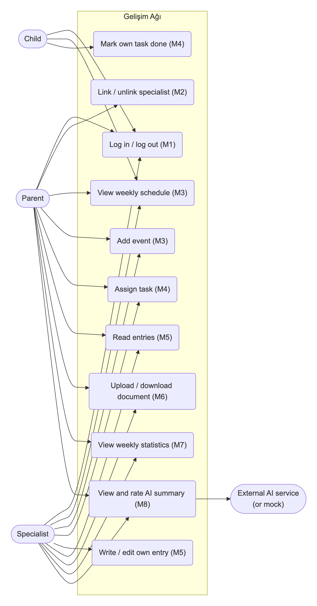

# Software Requirements Specification (SRS)

**Team name:** CoreStack (Group G1, Section-1)  
**Version:** ☒ First version (Week 6) ☐ Final (Week 10)  
**Last updated:** 2026-10-25  
**Project:** Gelişim Ağı – AI-Assisted Child Development Platform

| **Team member** | **Role** |
| --- | --- |
| Ceren Gökdere | Developer |
| Elif İstanbulluoğlu | Project Manager |
| Aytuğ Saygı | Tester |

Repository: [https://github.com/cgokdere/core-stack](https://github.com/cgokdere/core-stack) · CI: [https://github.com/cgokdere/core-stack/actions/workflows/ci.yml](https://github.com/cgokdere/core-stack/actions/workflows/ci.yml)

# 1\. Introduction

**Purpose of the system** (2–3 sentences):

Gelişim Ağı is a web platform that gives a child's parent, the child's specialists and the child one shared weekly schedule, one task list and one record of observations and documents. For each week it shows statistics and an AI-generated summary written for the parent or the specialist. The summary supports their decisions and never makes them.

**Users of the system:**

| **User type** | **Description** |
| --- | --- |
| **Parent** | Logs in, sees their own children, links and unlinks specialists, adds schedule events, assigns tasks, uploads and views documents, reads specialist entries, views weekly statistics and reads and rates the parent version of the AI summary. |
| **Specialist** (teacher, psychologist, doctor, special education teacher, coach) | Logs in and works only with children they are linked to: adds schedule events, assigns tasks, writes and edits their own entries, uploads and views documents, views weekly statistics and reads and rates the specialist version of the AI summary. |
| **Child** | Logs in, sees their own weekly schedule and task list and marks their own tasks as done. |

An external **AI service** (Gemini or GitHub Models, or a built-in mock) is a supporting system, not a user.

**Scope, status and assumptions:**

All requirements below describe the system planned for v1.0 (Week 12). As of this version the repository has the walking skeleton (a health check through every layer), the complete database schema with synthetic seed data, and CI. No requirement in Section 2 is available to users yet. Only the schema constraints behind FR-M1-02, FR-M1-06, FR-M2-02 and FR-M4-03 exist. The SDD records the status of each module.

Requirements without a mark follow from the Jira task titles (docs/JIRA\_PLAN.md), the database schema, the backend configuration or the project description. Requirements marked **†** contain a detail that none of these settles. They are proposals and the team must confirm them:

1.  **Accounts** are created by the seed script. The first version has no self-registration and no screen for creating children (FR-M1-01).
2.  **Session length** is not decided. 8 hours is proposed (FR-M1-04).
3.  The **login error** is generic, so it does not reveal whether the e-mail address exists (FR-M1-03).
4.  A parent identifies the **specialist to link** by the specialist's registered e-mail address (FR-M2-01).
5.  Only the **parent** links, lists and unlinks specialists (FR-M2-01, FR-M2-03, FR-M2-04).
6.  The **parent and linked specialists**, not the child, add events, assign tasks and upload documents (FR-M3-02, FR-M4-01, FR-M6-01).
7.  The **child** sees only their own schedule and tasks (FR-M3-05). The child has no access to entries, documents, statistics or AI summaries. The README says "an AI summary for each role", but the Jira plan has prompts only for parents and specialists (CST-52).
8.  Only the **child** can mark a task as done (FR-M4-06).
9.  **Weeks** run Monday to Sunday (FR-M3-01, FR-M7-01, FR-M8-01).
10.  **Accepted upload types** are PDF, JPEG and PNG (FR-M6-03). The 10 MB limit (FR-M6-02) comes from the backend configuration.
11.  The **statistics** metrics are proposed (FR-M7-01 – FR-M7-05). The Jira plan names only a "statistics service".
12.  **Smaller interface and validation details** are proposed: week navigation, end-after-start check, newest-first entries, and the empty-week and AI-error behaviour (FR-M3-03, FR-M3-04, FR-M5-03, FR-M8-05, FR-M8-07).

# 2\. Functional Requirements

Priority: **Must** (required for v1.0) / **Should** (planned) / **Could** (if time allows). Areas used throughout (from backend/src/constants.js): **academic, social, health, sport**.

## M1 – Login and roles

| **ID** | **Requirement** | **Priority** |
| --- | --- | --- |
| FR-M1-01 † | The system shall allow a registered user to log in with an e-mail address and a password. | Must |
| FR-M1-02 | The system shall treat e-mail addresses as case-insensitive during login. | Must |
| FR-M1-03 † | The system shall reject a login with an unknown e-mail address or a wrong password and show one generic error message that does not reveal which of the two was wrong. | Must |
| FR-M1-04 † | The system shall keep a user logged in for subsequent requests until the user logs out or the session expires. | Must |
| FR-M1-05 | The system shall allow a logged-in user to log out. | Must |
| FR-M1-06 | The system shall give every user exactly one role: parent, specialist or child. | Must |
| FR-M1-07 | The system shall show each role, after login, only the screens and actions permitted for that role. | Must |
| FR-M1-08 | The system shall refuse any request for protected data or actions that is not made by a logged-in user. | Must |
| FR-M1-09 | The system shall refuse an action when the logged-in user's role is not permitted to perform it. | Must |

## M2 – Linking specialists

| **ID** | **Requirement** | **Priority** |
| --- | --- | --- |
| FR-M2-01 † | The system shall allow a parent to link a registered specialist to one of their own children, recording the specialty (teacher, psychologist, doctor, special education, coach). | Must |
| FR-M2-02 | The system shall prevent the same specialist from being linked to the same child more than once. | Must |
| FR-M2-03 † | The system shall show a parent the specialists linked to their child with name, specialty and link date. | Must |
| FR-M2-04 † | The system shall allow a parent to unlink a specialist from their child only after the parent confirms the action. | Must |
| FR-M2-05 | The system shall show a parent the children registered to them and a specialist the children linked to them, so that the user can select a child. | Must |
| FR-M2-06 | The system shall give a user access to a child's data only if the user is that child's parent, a specialist currently linked to that child, or the child. | Must |
| FR-M2-07 | The system shall revoke a specialist's access to a child's data as soon as the specialist is unlinked. | Must |

## M3 – Weekly schedule

| **ID** | **Requirement** | **Priority** |
| --- | --- | --- |
| FR-M3-01 † | The system shall display a child's events for one selected calendar week, grouped by day. | Must |
| FR-M3-02 † | The system shall allow the parent or a linked specialist to add an event to a child's schedule with a title, a start date and time, an optional end date and time, and an area. | Must |
| FR-M3-03 † | The system shall reject an event whose title, start or area is missing, or whose end is before its start, and show which field is invalid. | Must |
| FR-M3-04 † | The system shall allow the user to move to the previous and the next week in the schedule view. | Should |
| FR-M3-05 † | The system shall show a child their own weekly schedule without the ability to change it. | Must |

## M4 – Tasks

| **ID** | **Requirement** | **Priority** |
| --- | --- | --- |
| FR-M4-01 † | The system shall allow the parent or a linked specialist to assign a task to a child with a title, an optional description, an area and a due date. | Must |
| FR-M4-02 | The system shall reject a task whose title, area or due date is missing and show which field is invalid. | Must |
| FR-M4-03 | The system shall give every new task the status "to do". | Must |
| FR-M4-04 | The system shall show a child their own tasks with title, description, area, due date and status. | Must |
| FR-M4-05 | The system shall allow a child to mark one of their own "to do" tasks as done and record the time of completion. | Must |
| FR-M4-06 † | The system shall prevent any user other than the child from marking a task as done. | Must |
| FR-M4-07 | The system shall show the parent and linked specialists a child's tasks with status, the user who assigned each task and the completion time. | Must |

## M5 – Specialist entries

| **ID** | **Requirement** | **Priority** |
| --- | --- | --- |
| FR-M5-01 | The system shall allow a linked specialist to add an entry for a child with a date, a title, a text body and an area. | Must |
| FR-M5-02 | The system shall reject an entry whose date, title, body or area is missing and show which field is invalid. | Must |
| FR-M5-03 † | The system shall show the parent and linked specialists a child's entries, newest first, with author name, author specialty and entry date. | Must |
| FR-M5-04 | The system shall allow the author of an entry to edit its date, title, body and area. | Must |
| FR-M5-05 | The system shall mark an edited entry as "edited" and show the time of the last edit to everyone who can see the entry. | Must |
| FR-M5-06 | The system shall prevent users from editing entries written by someone else. | Must |

## M6 – Documents

| **ID** | **Requirement** | **Priority** |
| --- | --- | --- |
| FR-M6-01 † | The system shall allow the parent or a linked specialist to upload a file for a child with a document type (report, evaluation, health, form, other). | Must |
| FR-M6-02 | The system shall reject an uploaded file larger than 10 MB with an error message stating the limit. | Must |
| FR-M6-03 † | The system shall reject an uploaded file whose type is not PDF, JPEG or PNG with an error message listing the accepted types. | Must |
| FR-M6-04 | The system shall list a child's documents with original file name, document type, uploader, upload date and size. | Must |
| FR-M6-05 | The system shall allow a user with access to the child to download a document under its original file name. | Must |
| FR-M6-06 | The system shall allow a user with access to the child to open a PDF or image document in the browser without downloading it first. | Should |

## M7 – Weekly statistics

| **ID** | **Requirement** | **Priority** |
| --- | --- | --- |
| FR-M7-01 † | The system shall show the parent and linked specialists, for one child and one selected week, the number of tasks due and the number of those tasks completed, per area. | Must |
| FR-M7-02 † | The system shall show the task completion rate of the selected week as a percentage. | Should |
| FR-M7-03 † | The system shall show the number of events per area in the selected week. | Should |
| FR-M7-04 † | The system shall show the number of specialist entries per area in the selected week. | Should |
| FR-M7-05 † | The system shall show zero values instead of an error when the selected week contains no records. | Should |

## M8 – Role-based AI summary

| **ID** | **Requirement** | **Priority** |
| --- | --- | --- |
| FR-M8-01 | The system shall generate, on request by a parent, a summary of a child's tasks, events and entries for a selected week, written for the parent. | Must |
| FR-M8-02 | The system shall generate, on request by a linked specialist, a summary of a child's tasks, events and entries for a selected week, written for a specialist. | Must |
| FR-M8-03 | The system shall show with each summary the list of records (tasks, events, entries) the summary is based on. | Must |
| FR-M8-04 | The system shall label every summary as AI-generated and state that it supports but does not replace the user's own decisions. | Must |
| FR-M8-05 † | The system shall tell the user that no summary can be produced when the selected week has no tasks, events or entries. | Should |
| FR-M8-06 | The system shall be able to generate summaries in a mock mode that does not contact any external AI service. | Must |
| FR-M8-07 † | The system shall show an error message when the external AI service fails or does not answer, and leave the rest of the application usable. | Should |
| FR-M8-08 | The system shall allow the parent or specialist to rate a summary as "helpful" or "incorrect" and store the rating with the child, the user, the role and the week. | Should |

# 3\. Non-Functional Requirements

Thresholds marked **(proposed)** are targets the team still has to confirm. No threshold has been measured yet.

| **ID** | **Category** | **Requirement** |
| --- | --- | --- |
| NFR-01 | Security | The system shall store passwords only as bcrypt hashes (already done by the seed script). Every API endpoint except the health check and login shall reject requests without a valid session with HTTP 401, and requests for a child the user may not access with HTTP 403. **Measure:** no plain-text password in the database, and an automated test for 401 and 403 on every child route. |
| NFR-02 | Security / privacy | The repository, seed data and demos shall contain only synthetic personal data (as backend/src/seed.js does now). **(proposed)** When an external AI service is used, the system shall send it only the selected child's records for the selected week, never e-mail addresses or password hashes. **Measure:** review of the seed script and the AI prompt builder before each release. |
| NFR-03 | Reliability | The system shall answer every API error with a JSON body that contains an error field and a 4xx/5xx status code (done for unknown /api paths). The CI pipeline shall pass before any pull request is merged into main. **Measure (from the sprint plan):** branch coverage at least 40% at v0.2 and at least 60% at v1.0, and end-to-end tests for the three critical flows at v0.2. |
| NFR-04 | Performance **(proposed)** | On the seeded data set, measured on a developer laptop, 95% of non-AI API requests shall complete within 500 ms. An AI summary shall complete within 2 s in mock mode and within 15 s with an external provider. |
| NFR-05 | Usability and compatibility | The user interface shall be in Turkish (the page language is already tr). The backend shall run on Node.js 22 or newer without a separate database server (CI runs on Node.js 22). **(proposed)** Every main screen shall be usable on current Chrome, Firefox and Safari at widths of 360 px and 1280 px, with visible labels on all form fields and full keyboard operation, checked manually before each release. |

# 4\. Critical Flows and Acceptance Criteria

The demo accounts below are the synthetic accounts created by npm run seed.

| **Flow** | **Related requirements** | **Acceptance criteria** |
| --- | --- | --- |
| Flow 1: Log in and open the role's home screen | FR-M1-01, FR-M1-02, FR-M1-03, FR-M1-04, FR-M1-07, FR-M1-08, FR-M1-09, FR-M2-05 | 1\. **Given** the parent account selin.yildiz@example.com with password Password123! **When** the user logs in with Selin.Yildiz@example.com and that password **Then** the system logs the user in and shows the parent home screen with the child "Deniz Yıldız". 2\. **Given** a registered account **When** the user logs in with a wrong password or an unknown e-mail address **Then** the system shows the same generic error in both cases and does not log the user in. 3\. **Given** a user who is not logged in **When** the user requests any child's schedule, tasks, entries, documents, statistics or AI summary **Then** the system refuses the request and shows the login screen. 4\. **Given** a logged-in child **When** the child tries a parent-only action such as linking a specialist **Then** the system refuses the action. |
| Flow 2: Assign a task and complete it as the child | FR-M2-06, FR-M4-01, FR-M4-02, FR-M4-03, FR-M4-04, FR-M4-05, FR-M4-06, FR-M4-07 | 1\. **Given** a specialist linked to a child **When** the specialist assigns a task with title "Read 10 pages", area "academic" and a due date **Then** the task appears in the child's task list with the status "to do". 2\. **Given** the assign form **When** the title, area or due date is missing **Then** the system creates no task and shows which field is missing. 3\. **Given** a specialist who is not linked to the child **When** the specialist tries to assign a task to that child **Then** the system refuses the request and creates no task. 4\. **Given** a logged-in child with a "to do" task **When** the child marks it as done **Then** its status becomes "done", the completion time is recorded, and the parent and linked specialists see the new status. 5\. **Given** a parent or specialist viewing the child's tasks **When** they try to mark a task as done **Then** the system refuses the action and the status stays "to do". |
| Flow 3: View and rate the weekly AI summary | FR-M2-06, FR-M8-01, FR-M8-02, FR-M8-03, FR-M8-04, FR-M8-05, FR-M8-06, FR-M8-07, FR-M8-08 | 1\. **Given** a parent whose child has tasks, events or entries in the selected week, and the AI service in mock mode **When** the parent opens the AI summary for that week **Then** the system shows a summary written for the parent, labelled as AI-generated, with the list of records it is based on. 2\. **Given** a linked specialist and the same week **When** the specialist opens the AI summary **Then** the system shows the specialist version with its own source list. 3\. **Given** a week with no tasks, events or entries **When** the user opens the AI summary **Then** the system says there is nothing to summarise and does not call the AI service. 4\. **Given** an external AI service that returns an error or does not answer **When** the user opens the AI summary **Then** the system shows an error message and the other tabs keep working. 5\. **Given** a summary on screen **When** the user rates it "helpful" or "incorrect" **Then** the system stores the rating for that child, user, role and week and confirms it. |

# 5\. Use Case Diagram

Mermaid has no UML use case notation, so the diagram below is a flowchart: actors on the left, use cases (grouped by module) in the system boundary, and the external AI service on the right.

# 6\. Change Log

| **Date** | **Change** | **By** |
| --- | --- | --- |
| 2026-10-25 | First version: user types, functional requirements for M1–M8, non-functional requirements, three critical flows with acceptance criteria and use case diagram (CST-22). | Ceren Gökdere |
| 2026-10-25 | Aligned the layout with the instructor's SRS template. Marked every requirement detail not settled by the Jira plan, schema or configuration with † and listed it under Scope, status and assumptions. | Ceren Gökdere |
| 2026-11-01 | Converted from Word (docs/SRS.docx) to Markdown, as the course guide requires the document as docs/SRS.md. The content is unchanged; the diagram is now docs/img/srs-use-case-diagram.png. | Aytuğ Saygı |
