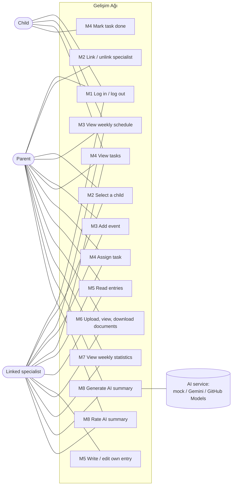

# Software Requirements Specification (SRS)

**Team name:** CoreStack (Group G1, Section-1)  
**Version:** ☐ First version (Week 6) ☒ Final (Week 10)  
**Last updated:** 2026-11-15  
**Project:** Gelişim Ağı – AI-Assisted Child Development Platform

| Team member | Role |
|---|---|
| Ceren Gökdere | Developer |
| Elif İstanbulluoğlu | Developer, project manager |
| Aytuğ Saygı | Developer, tester |

Repository: <https://github.com/cgokdere/core-stack> · CI: <https://github.com/cgokdere/core-stack/actions/workflows/ci.yml>

---

## 1. Introduction

**Purpose of the system:**

Gelişim Ağı is a web platform that gives a child's parent, the child's specialists and the child one shared weekly schedule, one task list and one record of observations and documents. For each week it shows task statistics and an AI-generated summary written for the parent or for the specialist. The summary supports their decisions and never makes them.

**Users of the system:**

| User type | Description |
|---|---|
| **Parent** | Logs in and sees their own children. Links and unlinks specialists, adds schedule events, assigns tasks, uploads and views documents, reads specialist entries, views weekly statistics, and reads and rates the parent version of the AI summary. |
| **Specialist** (teacher, psychologist, doctor, special education teacher, coach) | Logs in and works only with children they are linked to. Adds schedule events, assigns tasks, writes and edits their own entries, uploads and views documents, views weekly statistics, and reads and rates the specialist version of the AI summary. |
| **Child** | Logs in, sees their own weekly schedule and task list, and marks their own tasks as done. |

An external **AI service** (Gemini or GitHub Models, or the built-in mock) is a supporting system, not a user.

**What each role may do** (enforced by the backend on every request; see SDD Section 2):

| Action | Parent | Linked specialist | Child |
|---|---|---|---|
| See the child's schedule and tasks | ✓ | ✓ | ✓ (own) |
| Add an event, assign a task | ✓ | ✓ | – |
| Mark a task as done | – | – | ✓ (own) |
| Read specialist entries | ✓ | ✓ | – |
| Write an entry / edit an entry | – | ✓ / own only | – |
| Upload, view and download documents | ✓ | ✓ | – |
| Weekly statistics, AI summary and rating | ✓ | ✓ | – |
| Link and unlink specialists | ✓ | – | – |

**Decisions settled since the first version.** The first version marked open details with †. The implementation has settled them as follows, and the requirements below are written to match:

1. Accounts are created by the seed script. There is no self-registration and no screen for creating children.
2. A session lasts 8 hours (JWT). Reloading the page keeps the user logged in until then.
3. The login error is generic and does not reveal whether the e-mail address exists.
4. A parent links a specialist by the specialist's registered e-mail address. Only the parent links, lists and unlinks.
5. The parent and linked specialists add events, assign tasks and upload documents. Only linked specialists write entries.
6. The child sees only their own schedule and tasks. Only the child marks a task as done.
7. Weeks run Monday to Sunday. A week is addressed by any date inside it.
8. Accepted upload types are PDF, JPEG and PNG, detected from the file content. The limit is 10 MB.
9. The statistics are task-based: tasks due and completed per area, and the completion rate. Event and entry counts per area (FR-M7-03, FR-M7-04) were not built.
10. The AI summary is produced when the user presses "Özet oluştur" and is not stored. Ratings are stored.

Areas used throughout (`backend/src/constants.js`): **academic, social, health, sport**.

---

## 2. Functional Requirements

Priority: **Must** (required for v1.0) / **Should** (planned) / **Could** (if time allows).
Requirement IDs are unchanged from the first version. New requirements were added at the end of each module.

### M1 – Login and roles

| ID | Requirement | Priority |
|---|---|---|
| FR-M1-01 | The system shall allow a registered user to log in with an e-mail address and a password. | Must |
| FR-M1-02 | The system shall treat e-mail addresses as case-insensitive during login. | Must |
| FR-M1-03 | The system shall reject a login with an unknown e-mail address or a wrong password and show one generic error message ("E-posta veya şifre hatalı.") that does not reveal which of the two was wrong. | Must |
| FR-M1-04 | The system shall keep a user logged in, also across page reloads, until the user logs out or the 8-hour session expires. | Must |
| FR-M1-05 | The system shall allow a logged-in user to log out. | Must |
| FR-M1-06 | The system shall give every user exactly one role: parent, specialist or child. | Must |
| FR-M1-07 | The system shall show each role, after login, only the screens and actions permitted for that role (parent and specialist: children list and child workspace; child: own home page). | Must |
| FR-M1-08 | The system shall refuse any request for protected data or actions that is not made by a logged-in user. | Must |
| FR-M1-09 | The system shall refuse an action when the logged-in user's role is not permitted to perform it. | Must |
| FR-M1-10 | The system shall reject a login request in which the e-mail address or the password is empty. | Must |
| FR-M1-11 | The login page shall offer buttons for the synthetic demo accounts that fill in the e-mail field. | Could |

### M2 – Linking specialists

| ID | Requirement | Priority |
|---|---|---|
| FR-M2-01 | The system shall allow a parent to link a registered specialist to one of their own children by the specialist's e-mail address, recording the specialty (teacher, psychologist, doctor, special education, coach). If no specialty is given, the specialist's registered specialty is used. | Must |
| FR-M2-02 | The system shall prevent the same specialist from being linked to the same child more than once and show the message "Bu uzman zaten bağlı.". | Must |
| FR-M2-03 | The system shall show a parent the specialists linked to their child with name, e-mail, specialty and link date. | Must |
| FR-M2-04 | The system shall allow a parent to unlink a specialist from their child only after the parent confirms the action. | Must |
| FR-M2-05 | The system shall show a parent the children registered to them and a specialist the children linked to them, so that the user can select a child. | Must |
| FR-M2-06 | The system shall give a user access to a child's data only if the user is that child's parent, a specialist currently linked to that child, or the child, and only for the actions in the table in Section 1. | Must |
| FR-M2-07 | The system shall revoke a specialist's access to a child's data as soon as the specialist is unlinked. | Must |
| FR-M2-08 | The system shall reject a link request whose e-mail address does not belong to a registered specialist, with a message asking the parent to have the specialist register first. | Must |
| FR-M2-09 | The system shall open the child's workspace directly when a parent has exactly one child. | Could |

### M3 – Weekly schedule

| ID | Requirement | Priority |
|---|---|---|
| FR-M3-01 | The system shall display a child's events for one selected Monday–Sunday week, one column per day, in time order, and highlight today. | Must |
| FR-M3-02 | The system shall allow the parent or a linked specialist to add an event to a child's schedule with a title (at most 120 characters), a date, a start time, an optional end time and an area. | Must |
| FR-M3-03 | The system shall reject an event whose title, start or area is missing or invalid, or whose end is before its start, and show an error message naming the invalid field. | Must |
| FR-M3-04 | The system shall allow the user to move to the previous and the next week. The selected week applies to the schedule, tasks, statistics and AI summary. | Should |
| FR-M3-05 | The system shall show a child their own weekly schedule without the ability to change it. | Must |

### M4 – Tasks

| ID | Requirement | Priority |
|---|---|---|
| FR-M4-01 | The system shall allow the parent or a linked specialist to assign a task to a child with a title (at most 120 characters), an optional description (at most 500 characters), an area and a due date. | Must |
| FR-M4-02 | The system shall reject a task whose title, area or due date is missing or invalid and show an error message naming the invalid field. | Must |
| FR-M4-03 | The system shall give every new task the status "to do". | Must |
| FR-M4-04 | The system shall show a child their own tasks due in the selected week with title, description, area, due date, assigner and status. | Must |
| FR-M4-05 | The system shall allow a child to mark one of their own tasks as done and record the time of completion. Marking a done task again shall not change the recorded time. | Must |
| FR-M4-06 | The system shall prevent any user other than the child from marking a task as done. | Must |
| FR-M4-07 | The system shall show the parent and linked specialists a child's tasks with status and the user who assigned each task. | Must |
| FR-M4-08 | The system shall show, above the task list, how many of the week's tasks are done out of the total. | Should |
| FR-M4-09 | The system shall allow a specialist to narrow the task list to the tasks they assigned themselves ("Verdiklerim"). | Could |

### M5 – Specialist entries

| ID | Requirement | Priority |
|---|---|---|
| FR-M5-01 | The system shall allow a linked specialist to add an entry for a child with a date, a title (at most 120 characters), a text body (at most 2000 characters) and an area. | Must |
| FR-M5-02 | The system shall reject an entry whose date, title, body or area is missing or invalid and show an error message naming the invalid field. | Must |
| FR-M5-03 | The system shall show the parent and linked specialists a child's entries, newest first, with author name, author specialty and entry date. | Must |
| FR-M5-04 | The system shall allow the author of an entry to edit its date, title, body and area. | Must |
| FR-M5-05 | The system shall mark an edited entry as "Düzenlendi" and record the time of the last edit. | Must |
| FR-M5-06 | The system shall prevent users from editing entries written by someone else. | Must |
| FR-M5-07 | The system shall not let the parent or the child write entries, and shall not show entries to the child. | Must |

### M6 – Documents

| ID | Requirement | Priority |
|---|---|---|
| FR-M6-01 | The system shall allow the parent or a linked specialist to upload a file for a child with a document type (report, evaluation, health, form, other). An unknown type shall be stored as "other". | Must |
| FR-M6-02 | The system shall reject an uploaded file larger than 10 MB with the error message "Dosya en fazla 10 MB olabilir.". | Must |
| FR-M6-03 | The system shall reject an uploaded file that is not PDF, JPEG or PNG with an error message listing the accepted types. | Must |
| FR-M6-04 | The system shall list a child's documents, newest first, with original file name, document type, uploader, upload date and size. | Must |
| FR-M6-05 | The system shall allow the parent or a linked specialist to download a document under its original file name. | Must |
| FR-M6-06 | The system shall allow the parent or a linked specialist to open a PDF or image document in a new browser tab without downloading it first. | Should |
| FR-M6-07 | The system shall decide the file type from the file content, not from the file name or the declared type. | Must |
| FR-M6-08 | The system shall not show documents to the child. | Must |

### M7 – Weekly statistics

| ID | Requirement | Priority |
|---|---|---|
| FR-M7-01 | The system shall show the parent and linked specialists, for one child and one selected week, the number of tasks due and the number of those tasks completed, per area, with the completion rate of each area. | Must |
| FR-M7-02 | The system shall show the total task completion rate of the selected week as a percentage. | Should |
| FR-M7-03 | The system shall show the number of events per area in the selected week. | Could |
| FR-M7-04 | The system shall show the number of specialist entries per area in the selected week. | Could |
| FR-M7-05 | The system shall show zero values instead of an error when the selected week contains no tasks. | Should |
| FR-M7-06 | The system shall show the parent and linked specialists, above the child's tabs, a weekly overview: completion rate, number of open tasks, number of events and the next upcoming event. | Should |

### M8 – Role-based AI summary

| ID | Requirement | Priority |
|---|---|---|
| FR-M8-01 | The system shall generate, on request by a parent, a summary of a child's tasks, events and entries for the selected week, written for the parent. | Must |
| FR-M8-02 | The system shall generate, on request by a linked specialist, a summary of a child's tasks, events and entries for the selected week, written for a specialist and grouped by area. | Must |
| FR-M8-03 | The system shall show with each summary the numbered list of records (tasks, events, entries) the summary is based on. | Must |
| FR-M8-04 | The system shall label every summary as "AI-generated" and state that the AI does not decide, diagnose or suggest treatment and that the user decides. | Must |
| FR-M8-05 | The system shall tell the user that there is nothing to summarise when the selected week has no tasks, events or entries, without calling the AI service. | Should |
| FR-M8-06 | The system shall be able to generate summaries in a mock mode that does not contact any external AI service. | Must |
| FR-M8-07 | The system shall show an error message when the external AI service fails, and leave the rest of the application usable. | Should |
| FR-M8-08 | The system shall allow the parent or specialist to rate a summary as "helpful" or "incorrect" and store the rating with the child, the user, the role and the week. | Should |
| FR-M8-09 | The system shall cite source records in the summary text by number (for example [2]) and link each citation to the matching record in the source list. | Must |
| FR-M8-10 | The system shall instruct the AI service to use only the given records, not to invent facts, and never to state a diagnosis, treatment, medication or decision. | Must |
| FR-M8-11 | The system shall not offer the AI summary or rating to the child. | Must |

### Implementation status

All requirements above are implemented on `main` (merged 2026-11-15) and covered by backend tests (`backend/tests/`), except:

| ID | Status |
|---|---|
| FR-M5-05 | Partial. The "Düzenlendi" badge is shown and the edit time is stored and returned by the API (`editedAt`), but the screen does not display the edit time yet. |
| FR-M7-03, FR-M7-04 | Not implemented. Lowered from Should to Could. The overview (FR-M7-06) shows the total number of events only. |
| FR-M8-07 | Partial. Provider errors return HTTP 502 and the UI shows the message. There is no explicit timeout, so a provider that never answers keeps the request open. |

---

## 3. Non-Functional Requirements

| ID | Category | Requirement |
|---|---|---|
| NFR-01 | Security | Passwords shall be stored only as bcrypt hashes. Every API endpoint except the health check and login shall answer HTTP 401 without a valid session and HTTP 403 for a child the user may not access (the same 403 for a child that does not exist). **Measure:** backend tests for 401 and 403 on every module's routes (`auth.test.js`, and the access tests in each module test file). Met. |
| NFR-02 | Security / privacy | The repository, seed data and demos shall contain only synthetic personal data (`example.com` addresses). When an external AI service is used, the system shall send it only the selected child's records for the selected week (titles, entry texts, areas, dates, entry author names and the child's name), never e-mail addresses or password hashes. **Measure:** test `sends only the child's records and the role prompt to Gemini` and review of `aiPrompts.js` before each release. Met. |
| NFR-03 | Reliability | The system shall answer every API error with a JSON body that contains an `error` field and a 4xx/5xx status code. The CI pipeline shall pass before any pull request is merged into `main`. **Measure:** branch coverage at least 40% at v0.2 and at least 60% at v1.0; end-to-end tests for the three critical flows at v0.2. Coverage on 2026-11-15: backend 94.2% branches (83 tests), frontend 94.2% branches (76 tests). End-to-end tests: not yet written. |
| NFR-04 | Performance | On the seeded data set, measured on a developer laptop, 95% of non-AI API requests shall complete within 500 ms. An AI summary shall complete within 2 s in mock mode and within 15 s with an external provider. **Measure:** not yet measured; planned with the end-to-end tests. |
| NFR-05 | Usability and compatibility | The user interface shall be in Turkish (`<html lang="tr">`, all labels and messages). Every form field shall have a visible label, and the main screens shall be usable with the keyboard (skip link, tabs and buttons). The backend shall run on Node.js 22 or newer without a separate database server. **Measure:** CI runs on Node.js 22; manual check on current Chrome, Firefox and Safari at 360 px and 1280 px before each release. |

---

## 4. Critical Flows and Acceptance Criteria

The demo accounts are the synthetic accounts created by `npm run seed`; all use the password `Password123!`.

| Flow | Related requirements | Acceptance criteria |
|---|---|---|
| Flow 1: Log in and open the role's home screen | FR-M1-01 – FR-M1-05, FR-M1-07 – FR-M1-10, FR-M2-05, FR-M2-09 | 1. **Given** the parent account `selin.yildiz@example.com` **When** the user logs in with `Selin.Yildiz@example.com` and the correct password **Then** the system opens the workspace of the parent's only child, "Deniz Yıldız". 2. **Given** a registered account **When** the user logs in with a wrong password or an unknown e-mail address **Then** the system shows "E-posta veya şifre hatalı." in both cases and does not log the user in. 3. **Given** the specialist `elif.arslan@example.com` **When** she logs in **Then** the system lists exactly the two children she is linked to. 4. **Given** the child `deniz.yildiz@example.com` **When** the child logs in **Then** the system shows "Merhaba Deniz!" with the child's own tasks and schedule and no other tabs. 5. **Given** a user who is not logged in **When** the user requests any child route **Then** the API answers 401 and the app shows the login page. |
| Flow 2: Assign a task and complete it as the child | FR-M2-06, FR-M4-01 – FR-M4-07 | 1. **Given** a specialist linked to a child **When** the specialist assigns a task with title "10 sayfa oku", area "Akademik" and a due date in the selected week **Then** the task appears in the child's task list with the status "Bekliyor" and the specialist as assigner. 2. **Given** the assign form **When** the title or due date is missing or invalid **Then** the system creates no task and shows the error for that field. 3. **Given** a specialist who is not linked to the child **When** the specialist tries to assign a task to that child **Then** the API answers 403 and creates no task. 4. **Given** a logged-in child with an open task **When** the child presses "Yaptım!" **Then** its status becomes "Tamamlandı", the completion time is recorded, and the parent and linked specialists see the new status and the updated completion rate. 5. **Given** a parent or specialist **When** they try to mark a task as done **Then** the screen offers no button and the API answers 403. |
| Flow 3: View and rate the weekly AI summary | FR-M2-06, FR-M8-01 – FR-M8-11 | 1. **Given** a parent whose child has records in the selected week and the AI service in mock mode **When** the parent presses "Özet oluştur" **Then** the system shows a summary written for the parent, labelled "AI-generated", with numbered citations linked to the list of source records. 2. **Given** a linked specialist and the same week **When** the specialist presses "Özet oluştur" **Then** the system shows the specialist version, grouped by area, with its own source list. 3. **Given** a week with no tasks, events or entries **When** the user requests a summary **Then** the system shows "Bu hafta için özetlenecek kayıt bulunamadı." and does not call the AI service. 4. **Given** an external AI service that returns an error **When** the user requests a summary **Then** the API answers 502, the screen shows an error message and the other tabs keep working. 5. **Given** a summary on screen **When** the user presses "Faydalı" or "Hatalı bilgi bildir" **Then** the system stores the rating for that child, user, role and week and shows "Geri bildiriminiz için teşekkürler.". 6. **Given** the child or an unlinked specialist **When** they request a summary or send a rating **Then** the API answers 403. |

Each criterion is checked today by backend tests (`auth.test.js`, `tasks.test.js`, `ai.test.js`, `feedback.test.js`) and frontend tests. The browser end-to-end tests for the three flows are planned for v0.2 (CST-26, CST-39, CST-55).

---

## 5. Use Case Diagram

Mermaid has no UML use case notation, so the diagram is a flowchart: actors on the left, use cases grouped by module inside the system boundary, and the external AI service on the right.

---

## 6. Change Log

| Date | Change | By |
|---|---|---|
| 2026-10-25 | First version: user types, functional requirements for M1–M8, non-functional requirements, three critical flows with acceptance criteria and use case diagram (CST-22). | Ceren Gökdere |
| 2026-10-25 | Aligned the layout with the instructor's SRS template. Marked every requirement detail not settled by the Jira plan, schema or configuration with † and listed it under Scope, status and assumptions. | Ceren Gökdere |
| 2026-11-01 | Converted from Word (docs/SRS.docx) to Markdown, as the course guide requires the document as docs/SRS.md. | Aytuğ Saygı |
| 2026-11-15 | Final version, updated to the code on `main` after M1–M8 were merged (PR #8). Replaced the † assumptions with the decisions the implementation settled and added a role permission table. Reworded requirements to match the built behaviour (specialty default, 8-hour session, content-based file type check, task-based statistics, AI summary on request). Added FR-M1-10, FR-M1-11, FR-M2-08, FR-M2-09, FR-M4-08, FR-M4-09, FR-M5-07, FR-M6-07, FR-M6-08, FR-M7-06, FR-M8-09 – FR-M8-11. Lowered FR-M7-03 and FR-M7-04 to Could (not built). Added an implementation status table, measured coverage in NFR-03, updated the acceptance criteria to the real screen texts, and replaced the use case image with a Mermaid diagram (CST-27). | Ceren Gökdere |
